# Agent Registry Hub

**One governed registry for AI Agents, MCP servers, Tools and Skills on Databricks.** It shows who owns each asset, what it costs and how it's used, and lets owners grant access from the UI. It also tracks who consumes each asset (always by email), so every change can be assessed for downstream impact before it ships.

It's a Databricks App (React 19 + FastAPI monolith) backed by **Lakebase** for fast reads and a tamper-evident audit trail. An hourly sync job collects data from Agent Bricks, Model Serving, Genie, Unity Catalog (connections, MCP services, functions, skills), Unity Gateway system tables, billing and MLflow.

**Live app (Databricks SSO):** https://agent-registry-hub-1234567890123456.aws.databricksapps.com, on `your-workspace`, deployed 2026-10-26

| Document | What's in it |
|---|---|
| [Confluence: Agent Registry Hub on Databricks](https://databricks.atlassian.net/wiki/spaces/FE/pages/6986399757) | Field-facing overview: why, features, screens, Platform Watch, deploy, verification |
| [Google Doc: Project Documentation (v0.2.0)](https://docs.google.com/document/d/1rtuYa748A7bp7jnqAYpqXv_twXlYOv4NysPIipi8hb4/edit) | A copy of the project documentation plus the research summary |
| [docs/PROJECT_DOCUMENTATION.md](docs/PROJECT_DOCUMENTATION.md) | Requirements → features, architecture, data model, roles, flows, deployment runbook, tests, limits |
| [docs/RESEARCH_SUMMARY.md](docs/RESEARCH_SUMMARY.md) | The research: Databricks APIs vs OSS MLflow vs gaps, UX benchmark patterns, live-workspace gotchas |
| [docs/research/](docs/research/) | Four detailed notes, plus real JSON samples from the workspace probe |
| [docs/API_CONTRACT.md](docs/API_CONTRACT.md) | Every endpoint and response shape (the source of `frontend/src/lib/types.ts`) |

## What you can do

- **Discover:** a faceted catalog across agents (Supervisor, Knowledge Assistant, custom, Genie, Agent Runtime), MCP servers (UC connections, managed UC functions, Unity Gateway MCP services incl. `system.ai.microsoft_365`), tools and skills.
- **Understand:** owner-maintained descriptions with field-level provenance, auto-pulled metadata, admin overrides and drift detection; trust badges; tools; policies and guardrail coverage; usage, cost and unit economics; traces and evals for Databricks-built agents.
- **Get access:** request access (justification, duration, terms), owner approval with an SLA, provisioning of UC or endpoint grants with expiry, and reminders and expiry sweeps.
- **Subscribe:** register your email (plus team DLs and the agent or app you build on top). You're notified of changes and asked to acknowledge the impact.
- **Ship changes safely:** an impact preview (subscribers, downstream agents and owners, unregistered consumers), pre-publish checks, frozen impact reports, acknowledgement tracking, and before/after metrics.
- **Stay current safely (Platform Watch):** subscribes to the Databricks release-notes and OSS MLflow/SDK/CLI feeds, probes new APIs in your workspace, regression-tests every update on a throwaway **Lakebase branch**, and prompts admins to **accept or delay** breaking changes. Non-breaking ones can upgrade automatically.
- **Govern:** steward curation, ownerless queues, roles, sync sources, a hash-chained audit trail with verify and export, an MCP Registry-compatible `/v0.1/servers`, and a usage-registration API (`POST /api/v1/usage`).
- **Interop (v0.3.0):** publish the hub's lineage to **Unity Catalog external lineage** (plan first, admin publish, the hub only touches objects it created; optional hourly step, off by default); show **Microsoft Agent 365** IDs under "Also registered in" (Graph through a UC connection, or an admin-center export, with steward review and field-level provenance); and edit a UC MCP service's **tool selection** with a live preview, where hiding tools is a breaking change announced to its consumers.

## Screenshots

| | |
|---|---|
| 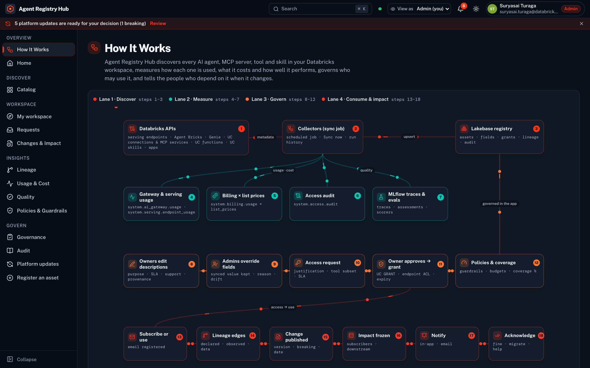 **How It Works** | 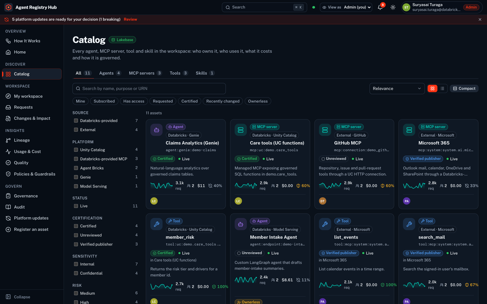 **Catalog** |
| 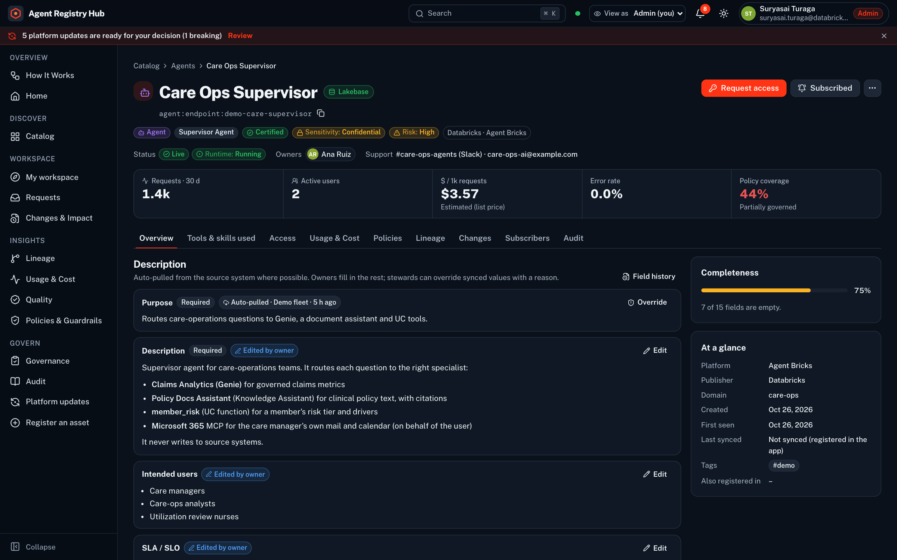 **Agent: description with provenance** | 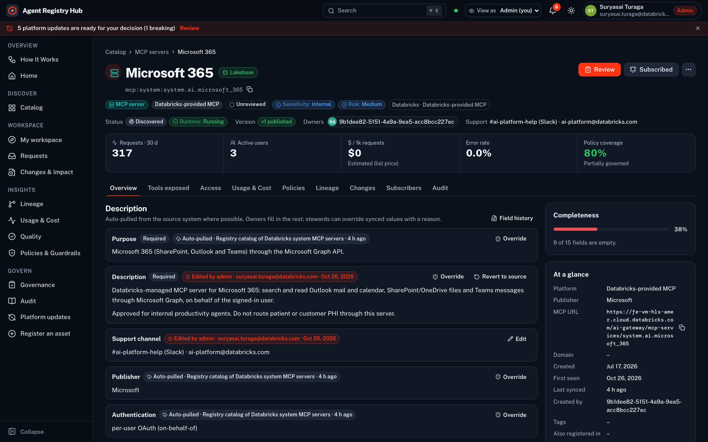 **External MCP: auto-pulled + admin override (live data)** |
| 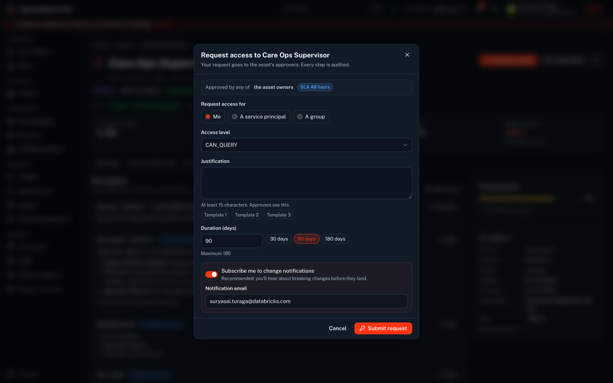 **Request access** | 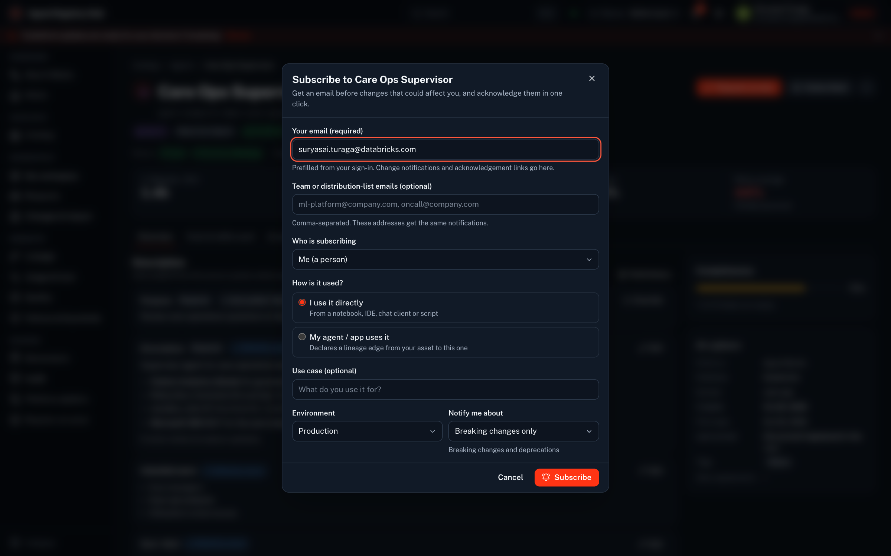 **Subscribe with email** |
| 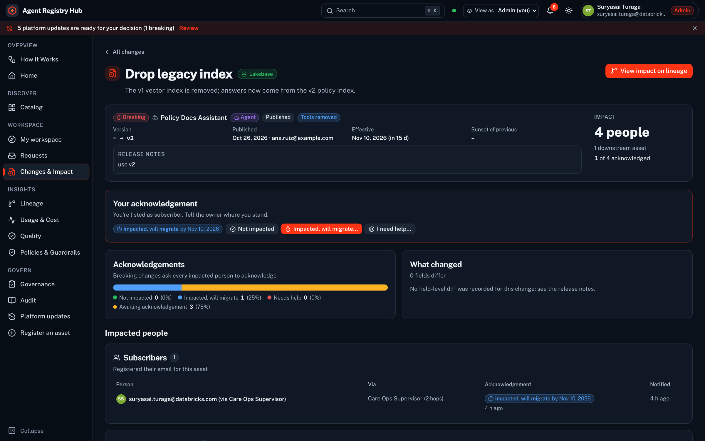 **Change impact report** | 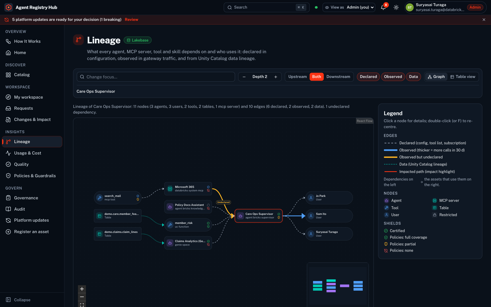 **Lineage explorer** |
| 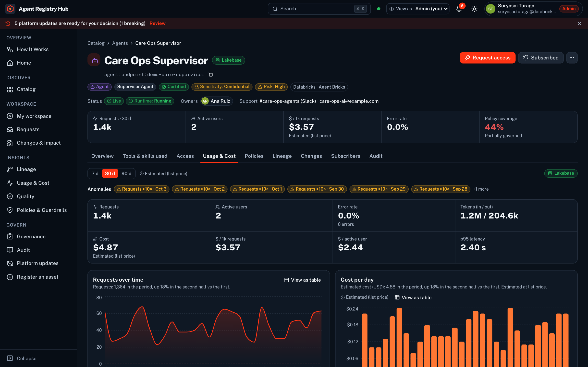 **Usage & cost** | 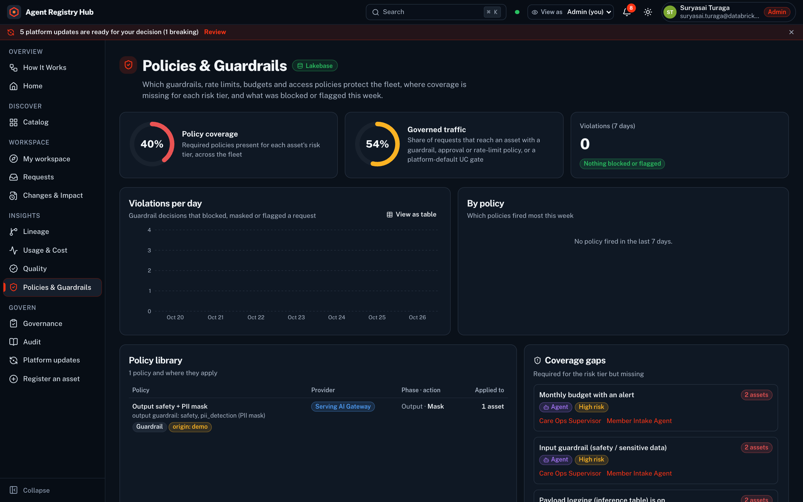 **Policies & guardrails** |
|  **Platform updates: branch regression** | 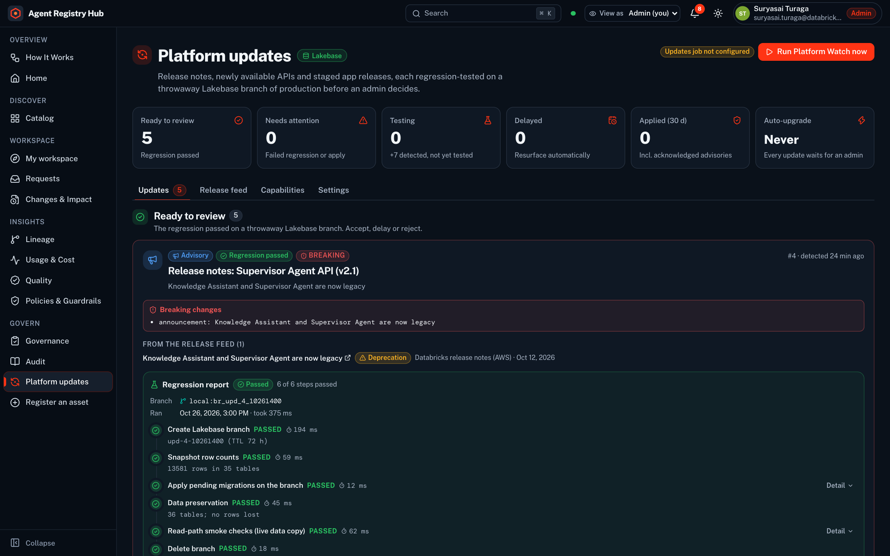 **Release feed (live)** |
| 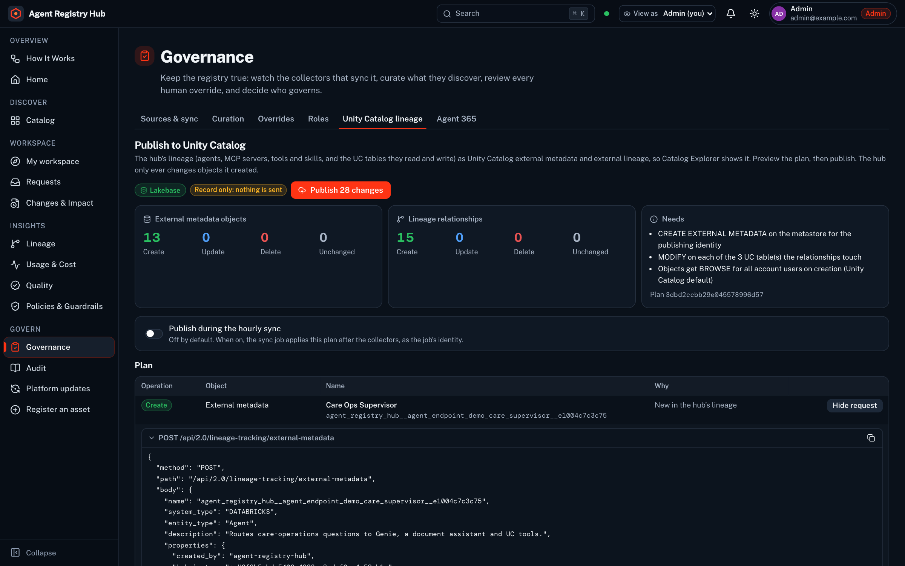 **Publish lineage to Unity Catalog: the plan** | 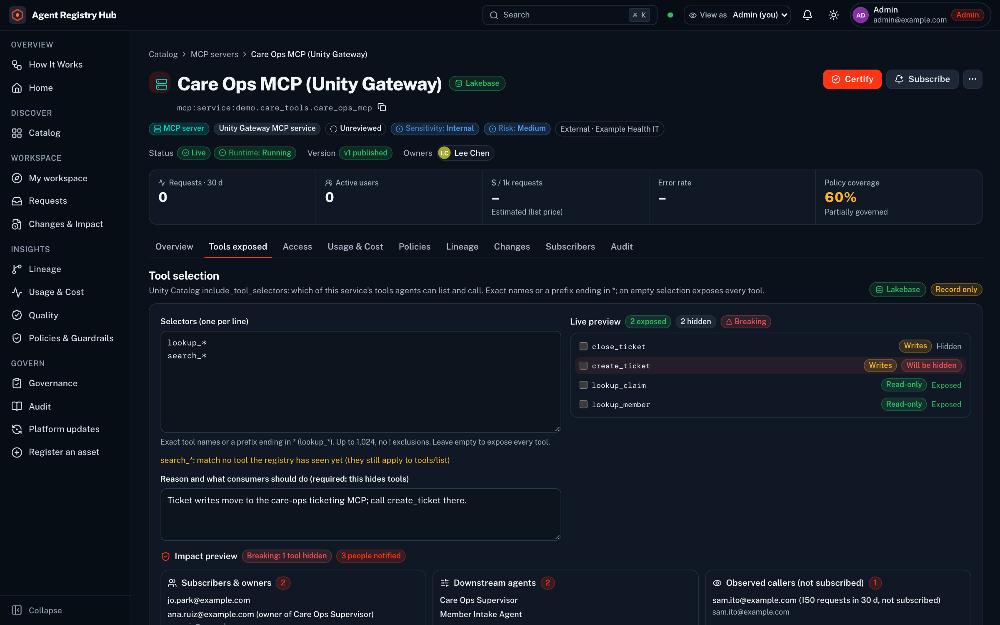 **MCP tool selection: live preview + impact** |
| 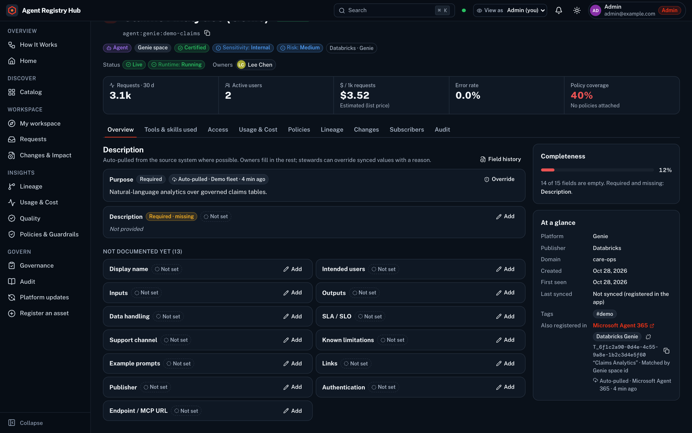 **Microsoft Agent 365 IDs in "Also registered in"** | |

All 26 screenshots are in [docs/screenshots/](docs/screenshots/), regenerated with `scripts/capture_screenshots.py`. Agent-centric pages use the fictional demo fleet. Pages marked *live data* come from a read-only sync of a real workspace.

## Layout

```
app/                      the deployed Databricks App (source_code_path)
  app.py                  FastAPI: /api routers → JSON 404 → /assets → SPA fallback; binds $DATABRICKS_APP_PORT
  core/                   platform foundation: Lakebase pool (OAuth), tiers (never-500 reads), guard, audit, migrate, health
  registry/               domain services: cards, fields, access, provision, subscriptions, changes, impact, graph,
                          lineage, usage, coverage, policies, quality, governance, auditlog, home, synthetic, background,
                          uc_lineage (UC external lineage), agent365, tool_selection, settings
  modules/*_api/          HTTP routers (access, insights, changes, admin, catalog, subregistry)
  collectors/             sync collectors: agent endpoints, Agent Bricks, Genie, MCP connections/managed/system, skills,
                          apps, usage, cost, traces & evals, optional Agent 365 (+ change detection in registry/versioning.py)
  static/                 built frontend (committed; Databricks Apps serves it)
frontend/                 React 19 · Vite 8 · TS 7 · Tailwind v4 HSL tokens · framer-motion · recharts · @xyflow/react
jobs/sync_registry.py     collectors entrypoint (local + job)
jobs/platform_updates.py  Platform Watch: feeds → probes → candidates → branch regression → apply
pipeline/                 migrations/ (additive SQL), setup_registry.py (migrations + app SP grants), run_sync.py (job wrapper)
resources/jobs.yml        setup + hourly sync jobs        databricks.yml   bundle: app + Lakebase project + targets
scripts/deploy.sh         build → deploy → setup → start → first sync → verify 200
tests/                    pytest: foundation, end-to-end registry flows, collectors (Docker Postgres)
docs/                     documentation, research, screenshots
```

## Quick start

```bash
./scripts/deploy.sh demo DEFAULT        # needs a free app slot in the workspace
```

For local development and tests, see [§8 of the project documentation](docs/PROJECT_DOCUMENTATION.md#8-local-development-and-tests).
